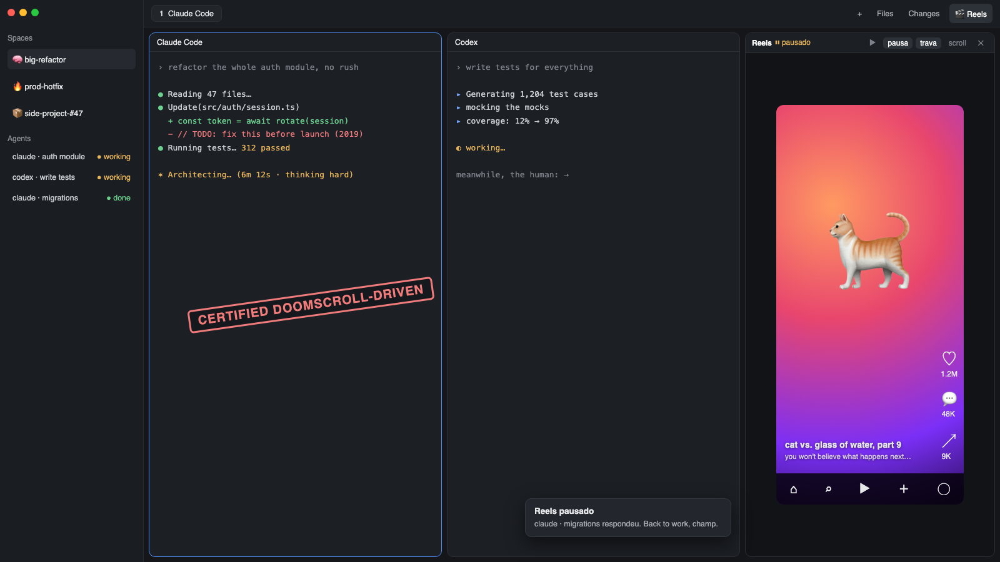

# 🎬 Doomscroll-Driven Development

> Your AI agents write the code. You watch Reels. Everyone wins. Mostly you.



You asked Claude to "refactor the whole auth module, no rush". It's going to take
six minutes. What are you going to do, *read the diff as it streams*? Be serious.

**Doomscroll-Driven Development (DDD™)** is a [Herdr](https://herdr.dev) layout that
puts Instagram Reels in a column right next to your coding agents, and then, out of
basic decency, **pauses the video the moment an agent finishes or needs you**.
Productivity was never on the table. Plausible deniability is.

## Features nobody asked for

| Button | What it does | Why |
| --- | --- | --- |
| **Reels** (tab bar) | Shows/hides the Reels column, right next to Files and Changes | So the shame is one click away |
| **pausa** | Pauses the reel when any Herdr agent stops working (done or blocked) | Your agent finished. Go look. Now. |
| **trava** | You can only scroll while at least one agent is working | No agent, no reels. Go give it a task |
| **scroll** | Jumps to the next reel when the current one ends | Hands-free doomscrolling (respects *trava*) |
| **▶ / ⏸** | Play / pause | For the brave who pause manually |
| **✕** | Hides the column (and pauses) | Your manager walked by |

Also: Cmd+Shift+R toggles the column, a toast tells you *which* agent answered, and
the whole thing is a real Chrome rendered into a Herdr terminal with Kitty images,
because Herdr has no web view and we have no shame.

## Install

Requirements: macOS, [Herdr](https://herdr.dev), Google Chrome, Node.js 18+ (on your PATH
in an interactive zsh).

```sh
git clone https://github.com/jpp000/doomscroll-driven-development
cd doomscroll-driven-development
./install.sh
```

Then click **Reels** in the tab bar and log into Instagram once (inside the column). The
login is kept in its own Chrome profile, not your everyday one.

`./uninstall.sh` removes everything (add `--purge` to also delete the browser profile and
login). Go write some tests.

## What it touches (it's polite, promise)

- **Adds** two mods: `mods/reels-bar` (the column) and `mods/tabs-reels` (the tab bar with
  the Reels button), plus a **new** layout `main-reels`: your `main` layout + the column.
  Your `main` layout is never edited; `Cmd+Shift+L` switches back.
- **Adds** Cmd+Shift+R to `keys.json`, only for the `main-reels` layout, and only if you
  haven't bound it there already.
- **Runs** one terminal named `reels` with `bin/reels-term.mjs` (a headless Chrome).
- **Stores** the browser profile in `~/.local/share/reels-widget` (folder `0700`).
- If a mod with the same name already exists, the installer moves it to a backup there
  instead of overwriting it.

## Security, because it's still your Instagram account

- Chrome is driven over a private pipe (`--remote-debugging-pipe`). **No debugging port
  is opened**, so no other program on your machine can reach the logged-in session.
- The Herdr mod controls the player over `127.0.0.1:9340`, which only accepts requests
  with a random token from a `0600` file (new on every start) and the exact `Host`
  header. Websites in your browser can't poke it.
- No telemetry, no servers, nothing leaves your machine except you watching Reels.

## How it works

```
Herdr layout "main-reels"
├── tab bar (tabs-reels)  ──── Reels button → layout.toggle "reels"
└── column "reels"
    ├── reels-bar (mod)   ──── watches agents(), talks to the player on :9340
    └── terminal "reels"  ──── node bin/reels-term.mjs
                                └── headless Chrome (pipe) → screencast → Kitty images
```

- `bin/reels-term.mjs` knows nothing about Herdr: it's a tiny terminal browser with a
  local control API. `reels-bar` knows nothing about Chrome. The tab button only toggles
  a layout node.
- The bar keeps `main-reels` equal to your `main` + the column, re-opens the browser if
  it dies, and fixes sizes if Herdr ever saves them wrong.

## Known limitations

- macOS + Google Chrome only (the path is hardcoded).
- Video is PNG frames into a terminal: fine for cats, not for 4K.
- Audio depends on headless Chrome. Your coworkers will thank you.
- Not affiliated with Instagram, Meta or Herdr. It's a browser showing a page you log
  into yourself. Use responsibly, or at least irresponsibly in moderation.

## 🇧🇷 Em português

Seus agentes codam, você assiste Reels. Quando um agente termina (ou precisa de você),
o vídeo pausa sozinho. Tem botão pra só deixar rolar enquanto algum agente está
trabalhando (**trava**) e auto scroll pro próximo reel (**scroll**). Instala com
`./install.sh`, desinstala com `./uninstall.sh`. Não mexe no seu layout `main`.

## License

Apache-2.0. `mods/tabs-reels` is derived from Herdr's `tabs` mod (Apache-2.0); see
[NOTICE](NOTICE).
