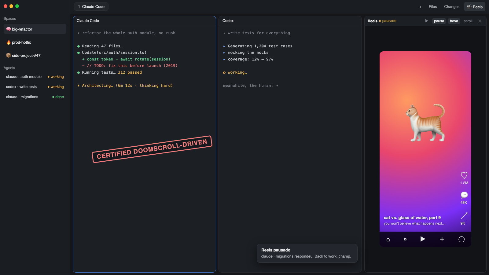

# Doomscroll-Driven Development

A Herdr layout that is the shipped `main` layout plus a 420px column on the right showing
Instagram Reels (a headless Chrome rendered into a terminal with Kitty images), with a
32px bar on top that pauses the video when any Herdr agent stops working. A **Reels**
button next to Files/Changes shows and hides the column.

## What you see

- Everything from `main`: sidebar (spaces, agents), tab bar, panes as cards, Files/Changes
  panel, status bar.
- Tab bar: after Changes, a **Reels** button (icon `mods/reels-bar/reels.svg`, 14px, label
  12px), same style as Files/Changes; `selected` background while the column is shown.
- Right of the work area, column `reels` (420px, min 320, max 900, radius 10, background
  `background`, no border of its own). Its outline is drawn in two parts that turn `accent`
  together while the browser has the keyboard, like a focused pane:
  - `reels-bar`, 32px, `surface` background, top/left/right border (rounded top 10): a
    7px dot (`working` playing, `blocked` locked, else `dim`), "Reels" (semibold, `accent`
    when focused), a state (`abrindo…` / `fechado` / `travado` / `tocando` / `pausado`),
    then on the right 24px icon buttons: play/pause (`icons/play.svg`, `icons/pause.svg`),
    options (`icons/options.svg`) and close (`mods/pane/close.svg`), each with a tooltip.
  - Options opens a 340×224 popup (the same mod with `props.menu`): one row per option,
    title + one-line description + a switch; a row that's on has the `selected` background.
    "Pausar quando um agente responder" (`reels.auto`), "Só rolar com agente trabalhando"
    (`reels.lock`), "Próximo reel automático" (`reels.autoscroll`).
  - `reels-view`, the rest: the `reels` terminal, border `border`, `focus` border `accent`,
    showing the page at phone width (360–520 CSS px).
- Pane navigation: `reels-bar` is `focusable`, so Cmd+Opt+Right lands on it and it hands
  the keyboard to the `reels` terminal. Herdr's `pane.go` refuses to start from a layout
  terminal block, so `keys.json` binds Cmd+Opt+Left in `layout:main-reels` to
  `reels-bar.left`: from the browser it focuses the last pane, elsewhere it runs `pane.go left`.

## How it behaves

- An agent going `working` → anything else (idle, done, blocked) pauses the video when
  **pausa** is on (default on) and posts a toast: "<agent> respondeu" or
  "<agent> precisa de você" for blocked.
- **trava** (default off): while no agent is `working`, mouse wheel and Up/Down/PageUp/
  PageDown don't reach the page.
- **scroll** (default off): when the centered video ends (or Instagram loops it back to
  0), scrolls the next video into view. Respects trava.
- Hiding the column (`✕`, the Reels button, Cmd+Shift+R) pauses the video.
- Clicks and typing go to the page (so you can log in); Ctrl+Q restarts the browser.

## Built from

- Layout `layouts/main-reels.json`: a copy of `main` with `tabs.content.mod =
  "tabs-reels"` and the `reels` column appended to `work-body`
  (`[{reels-bar block, mod reels-bar}, {reels-view block, terminal <address>}]`).
- `mods/tabs-reels`: Herdr's `tabs` mod (Apache-2.0) plus the button, which runs
  `layout.toggle {id: "reels"}`.
- `mods/reels-bar`: uses `agents()`, `terminals()`, `layout()`, `shared()`/`setShared()`
  (`reels.auto`, `reels.lock`, `reels.autoscroll`), `hc` (`ls`, `run`, `get`, `send`),
  `readTextFile`/`writeTextFile` (only `layouts/main-reels.json`), `fetch` to
  `127.0.0.1:9340` with header `x-reels-token`, `notify`, `run("layout.hide"|"layout.resize")`.
- `mods/reels-bar/bin/reels-term.mjs` (Node, no dependencies): headless Chrome over
  `--remote-debugging-pipe`, `Page.startScreencast` PNG frames drawn as Kitty images
  (two alternating ids), SGR mouse + keys forwarded with `Input.dispatch*`, control API on
  `127.0.0.1:9340` (`/pause /play /toggle /state /lock?on= /autoscroll?on=`), token in
  `~/.local/share/reels-widget/token` (0600).
- Programs it runs: `node`, Google Chrome, `hc`.

## Watch out

- **A terminal block whose terminal exits makes Herdr rewrite the layout and collapse
  single-child columns** (the reels column and `main`'s `panel`), saving their sizes as
  clicks on the wrong axis (the bar becomes 420px tall, Files gets a fixed height). So:
  the terminal runs `zsh -ic 'while true; do node "$0" …; done'` with `--keep` and is
  never killed; the bar rebuilds `main-reels` from `main` when it differs and resets bad
  sizes with `layout.resize`. After a core restart `--keep` leaves a shell: the bar types
  the command again only if the foreground program is a shell.
- Herdr's terminal doesn't decode JPEG in Kitty `f=100`; use PNG.
- Instagram rejects the `HeadlessChrome` user agent; set a normal one.
- A wheel tick doesn't beat Instagram's scroll snapping; use `scrollIntoView` for auto scroll.
- `ended` makes a video paused, so check it before the paused check.
- The bar only runs while the column has been shown at least once since the layout loaded.
- `terminal_padding` is only read from the layout root (a value on a block or column is
  accepted and ignored), so the page keeps the root's 14/12px inset.
- A node's `focus` border only applies to model panes, not to layout terminal blocks, and
  a border is all four sides: the line under the bar turns `accent` with the rest.
- macOS and `/Applications/Google Chrome.app` are assumed.

## Done when

- `herdr-app check` passes for both mods.
- Clicking **Reels** shows/hides the column; Files and Changes still open at full height.
- After logging in, a reel plays; when any agent finishes, it pauses and a toast names it.
- With **trava** on and no agent working, the wheel does nothing; it works again once an
  agent is working.
- Killing only the `node` process brings the browser back in the same terminal, with the
  layout unchanged.
- `lsof -iTCP -sTCP:LISTEN` shows no Chrome debugging port; requests to `:9340` without
  the token get 403.
